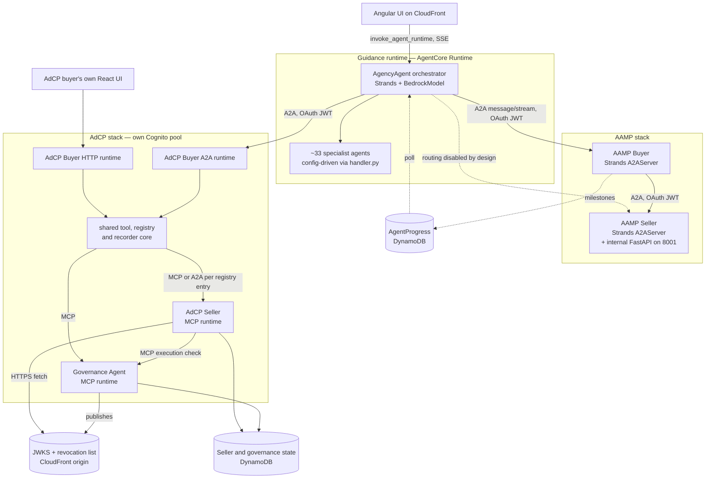
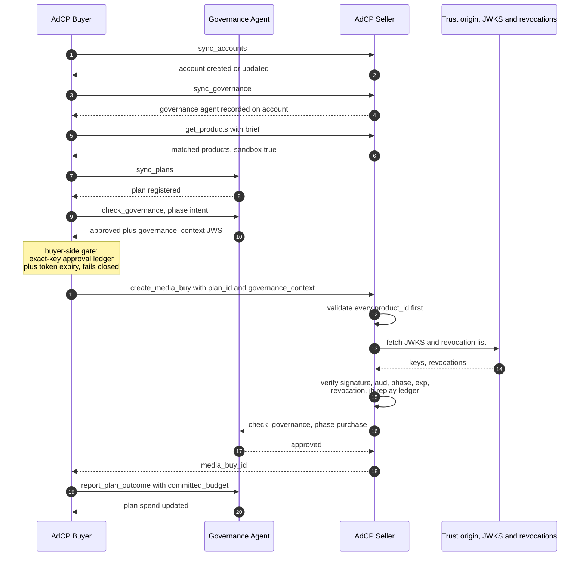
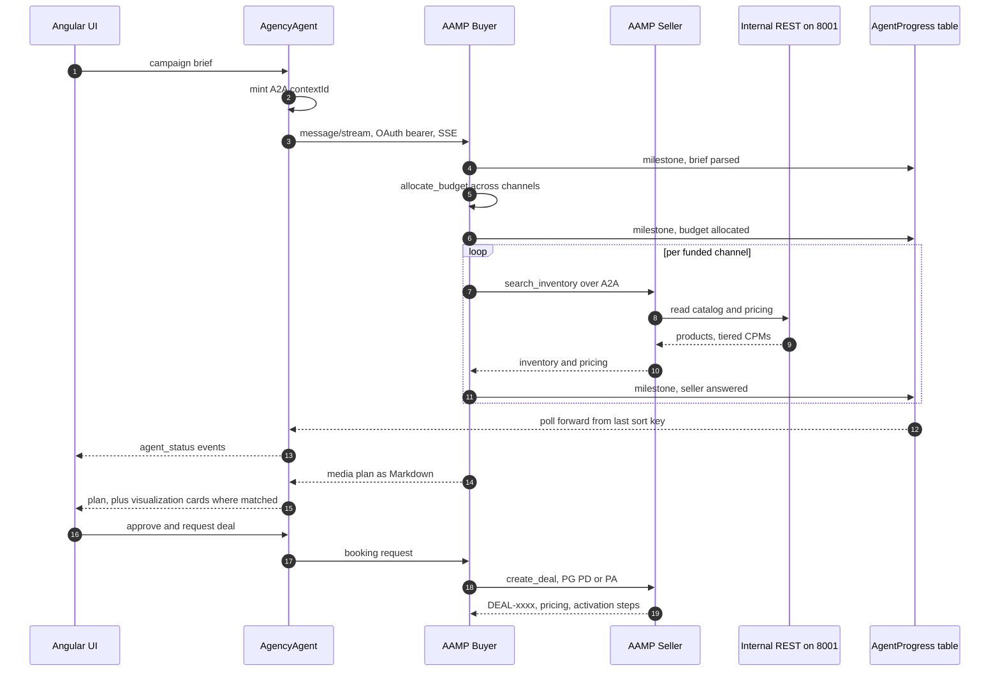

# Agentic Seller Architecture — AdCP and AAMP on Amazon Bedrock AgentCore

Architecture of the advertising **sell-side** in this solution: the components,
their responsibilities and interfaces, the transaction flows they participate
in, the trust model that binds them, and how all of it is hosted on Amazon
Bedrock AgentCore.

Audience: engineers extending a seller agent, integrating a new marketplace
protocol, or reviewing the trust boundaries.

---

## 1. Scope

The solution hosts **two independent sell-side marketplace stacks**. They share
a host platform and an orchestrator, but not a protocol, a transport, or a
deployment driver.

| | **AdCP stack** | **AAMP stack** |
| --- | --- | --- |
| Source | `external-agents/adcp/` | `external-agents/seller-agent/`, `external-agents/buyer-agent/` |
| Protocol | [Ad Context Protocol](https://docs.adcontextprotocol.org) — Media Buy, Accounts, Campaign Governance | IAB Tech Lab AAMP, OpenDirect 2.1, Deals API v1.0 |
| Agents | Buyer, seller, **governance** | Buyer, seller |
| Seller transport | MCP | A2A |
| Agent framework | Strands + `BedrockModel` | Strands + `BedrockModel` |
| Seller persistence | DynamoDB | SQLite in-memory, or Aurora + Redis |
| Inventory source | Fixture catalog | Pluggable adapter — CSV, S3, GAM, FreeWheel |
| Policy enforcement | Cryptographic, third-party governance agent | Seller-local price floor |
| Identity boundary | Its own Cognito user pool | The stack's Cognito pool |
| Deploy driver | `external-agents/adcp/deploy_all.py` | `scripts/deploy_aamp_agents.sh` |

**Design intent.** The two stacks are kept separate rather than unified behind a
common seller abstraction. Each marketplace protocol carries its own task
vocabulary, transport binding, and trust model, and each reference
implementation is a vendored upstream fork tracking its own community. An
abstraction over both would have to erase exactly the details that make each
implementation conformant. The cost of this choice is duplicated deployment and
identity machinery; the benefit is that either stack can be upgraded against its
own specification without coordinating with the other.

The two meet only at the orchestrator, which reaches both through one mechanism:
`external_agent_configs` entries in
`agentcore/deployment/agent/global_configuration.template.json`.

---

## 2. Architecture overview



**Text equivalent.** The Angular UI invokes the guidance runtime, addressing
`AgencyAgent`, which fans out to in-process specialists and to two external
peers over A2A with OAuth bearer tokens: the AAMP buyer and the AdCP buyer. The
AAMP buyer reaches the AAMP seller directly. The AdCP buyer's two runtimes share
one tool and registry core, which calls the AdCP seller and the governance
agent. The AdCP seller independently calls governance and pulls signing keys and
revocations over plain HTTPS. Progress for long-running buyer calls travels out
of band through a DynamoDB table.

### Layers

| Layer | Responsibility | Components |
| --- | --- | --- |
| **Presentation** | Conversational surface, visualization rendering | Angular UI; the AdCP buyer's own React UI |
| **Orchestration** | Intent routing, specialist coordination, approval gates | `AgencyAgent` and ~33 specialists on the guidance runtime |
| **Buy side** | Brief interpretation, budget allocation, plan assembly, negotiation | AdCP buyer; AAMP buyer |
| **Governance** | Policy authority, spend tracking, signed authorisation, audit | AdCP governance agent |
| **Sell side** | Inventory, pricing, availability, booking, delivery reporting | AdCP seller; AAMP seller |
| **Platform** | Runtime hosting, inbound identity, observability | AgentCore Runtime, Cognito, CloudWatch |
| **State** | Transaction state, session continuity, progress, trust material | DynamoDB, S3, CloudFront, KMS |

---

## 3. Component architecture

### 3.1 Orchestration — guidance runtime

`agentcore/deployment/agent/handler.py` is a single generic runtime that
materialises any of ~33 named agents from configuration. Strands is the agent
framework; `BedrockModel` is the LLM provider.

One agent definition supplies identity, model parameters, an instruction
template, built-in tool names, MCP servers, and external A2A peers. Three tool
sources compose onto one agent:

| Source | Config key | Produces |
| --- | --- | --- |
| Built-ins | `agent_tools` | `invoke_specialist`, `retrieve_knowledge_base_results_tool`, `http_request`, `lookup_events` |
| MCP servers | `mcp_servers` | Tools discovered from each server |
| External agents | `external_agent_configs` | One invoke tool per peer, A2A or direct runtime |

Instruction templates are resolved at load time: `{{AGENT_NAME}}`, arbitrary
keys from the agent's `injectable_values`, and `{{AGENT_NAME_LIST}}` — a JSON
array of every agent card, which lets an agent fuzzy-match a mistyped
`@AgentName` reference.

`AgencyAgent` supports two inventory-integration modes, selected per
conversation. **Direct AdCP** has the orchestrator call AdCP tasks itself.
**Publisher agent collaboration** delegates them to `PublisherAgent` over A2A.
The mode exists because both are legitimate real-world integration patterns and
the solution demonstrates each.

### 3.2 AdCP buyer

Deployed as **two runtimes over one shared core**, because a browser client and
a peer agent present different protocol contracts:

| Runtime | Entrypoint | Contract |
| --- | --- | --- |
| HTTP | `app.py`, port 8080 `/invocations` | Serves the buyer's React UI |
| A2A | `a2a_runtime/a2a_entrypoint.py`, port 9000 | Agent card at `/.well-known/`, JSON-RPC at root |

Both load the same tool set, seller registry, and session recorder, so
behaviour cannot diverge between the two surfaces.

**Tool surface** — fourteen tools spanning three peers: seller discovery and
transaction (`get_products`, `get_capabilities`, `list_creative_formats`,
`get_signals`, `create_media_buy`, `get_media_buys`,
`get_media_buy_delivery`, `get_creative_features`), account and governance
registration (`sync_accounts`, `sync_governance`), and the governance protocol
(`sync_plans`, `check_governance`, `report_plan_outcome`,
`get_plan_audit_logs`). Registration order is not call order — the model
chooses, constrained by the preconditions in §4.

**Seller registry** — sellers are configuration, not network discovery. An
environment-supplied registry is overlaid with runtime-registered entries from
DynamoDB and filtered by an administrative hide list. Each entry carries an id,
display name, transport, credentials, and two distinct URLs (§5).

**Fan-out** — read-only discovery tasks execute concurrently across every
scoped seller, returning a per-seller result or per-seller error. `create_media_buy`
is deliberately excluded: a media buy is a commitment to one counterparty.

### 3.3 AdCP seller

An MCP runtime implementing the sell-side task surface.

| Task group | Tasks |
| --- | --- |
| Capability | `get_adcp_capabilities`, `list_creative_formats` |
| Discovery | `get_products` |
| Transaction | `create_media_buy`, `update_media_buy` |
| Reporting | `get_media_buys`, `get_media_buy_delivery`, `provide_performance_feedback` |
| Accounts | `sync_accounts`, `list_accounts`, `sync_governance` |

That covers the required Media Buy tasks plus the Accounts protocol. The agent
declares no creative library, so `sync_creatives` is absent from its capability
response rather than present and inert — capability advertisement is part of the
protocol contract.

**Idempotency** is applied to mutating tasks and deliberately omitted from
reads. Interception requires both an `idempotency_key` and a caller identity on
the tool context; the tool-context factory exists so that identity is always
available, and `create_media_buy` additionally rejects a missing key outright.

**Inventory** is a fixture catalog matched by brief keywords. Every response
carries a `sandbox` flag, so a buyer can distinguish a reference counterparty
from a live one without out-of-band knowledge.

**State** lives in two DynamoDB tables: agent state (media buys, accounts,
idempotency records, the replay ledger) and session records.

### 3.4 Governance agent

A third party to every transaction, not a library linked into either side. It
holds the advertiser's plan — budget authority, flight window, geographic and
channel constraints — and issues signed authorisations against it.

| Task | Role in the flow |
| --- | --- |
| `sync_plans` | Register or update a plan's authority and constraints |
| `check_governance` | Evaluate a proposed action; return a verdict |
| `report_plan_outcome` | Record confirmed spend against the plan |
| `get_plan_audit_logs` | Retrieve the decision trail; either party may ask |

**Three verdicts, with distinct authority:**

| Verdict | Carries | Meaning |
| --- | --- | --- |
| `approved` | `governance_context` — a compact JWS signed by KMS | Authorising. The seller will accept it. |
| `conditions` | `consultation_context` | **Not** authorising. The buyer must adjust and re-check, passing this handle. |
| `denied` | Explanation | Terminal for this proposal. |

Separating an authorising token from a non-authorising consultation handle is
what prevents "the governance agent replied" from being mistaken for "the
governance agent approved".

**Gate ordering** in `check_governance` is a correctness property, not an
optimisation. The request shape is validated first; account ownership is checked
**before** anything about the plan is revealed; and an unknown plan returns
`denied` but is still recorded, because "you have not synced this plan" and
"this action breaches your plan" are different facts and both belong in the
audit trail.

**Phase is derived from the check type**, never read from the request. The
protocol SDK defaults the phase field to `purchase`, so an intent check that
did not explicitly set it would mint a token stamped `purchase` — which a
conformant seller rejects. Deriving it removes the failure mode.

Signing uses a KMS asymmetric key, ECDSA P-256 SHA-256, under a per-instance
alias. The runtime does not start without it. Operating modes are
`audit | advisory | enforce`, recorded on every audit entry.

Where a task is outside this agent's scope — creative features, property-list
CRUD — it returns `UNSUPPORTED_FEATURE` rather than a plausible answer. A
capability response that overstates the agent would make conformance testing
meaningless.

### 3.5 AAMP seller

A Strands agent served over A2A, adapted from the upstream IAB seller agent.
The A2A entrypoint imports no CrewAI; its container installs a Strands-only
dependency set.

**Two processes in one runtime.** The A2A server binds port 9000. An internal
FastAPI application, started through the lifespan hook in a daemon thread of the
same process, binds 8001 and serves catalog, pricing, and rate-card reads. The
agent's read tools call that REST surface rather than the co-resident MCP server,
because the MCP catalog path pulls in CrewAI transitively and the A2A image
excludes it. Sharing a process means one in-memory database serves both.

**Per-context agent construction.** An agent factory keyed on the A2A context id
builds a fresh agent per conversation, which the A2A server then reuses for
subsequent requests in that context. Negotiation history is retained per
conversation without leaking across conversations — the isolation boundary is
the context, not the runtime.

**Tools** — inventory and pricing reads, plus `create_deal` covering programmatic
guaranteed, preferred, and private auction. The seller price floor is enforced in
the tool; a violation returns a structured `price_below_floor` carrying the
seller minimum, so the buyer can counter rather than merely fail.

**Inventory adapters** are selected at deploy time: bundled CSV, S3 (data
updates without redeployment), Google Ad Manager, or FreeWheel. Persistence is
likewise selectable: in-memory SQLite with a public network mode, or Aurora and
Redis inside a VPC.

**Deployment modes.** The seller's deploy script exposes `a2a` — the current
path — alongside `mcp`, `http`, `chat`, `crew`, and `all`, which are the legacy
CrewAI surfaces. These are retained because the roadmap has the buyer reaching
the seller over MCP, which requires the MCP server to stay live.

### 3.6 AAMP buyer

A Strands A2A agent that interprets a brief, allocates budget across channels,
and sources real inventory and pricing from the seller per funded channel. It
returns a media plan as Markdown, which the UI renders directly and may
additionally match against visualization templates to produce cards.

It emits progress milestones to a shared table as it works (§7).

### 3.7 Routing: the orchestrator calls one AAMP agent

`AgencyAgent` is wired to the AAMP **buyer** only. The seller's tool entry is
present but disabled, so the tool builder skips it. The buyer already returns
seller-sourced inventory and pricing, so exposing both agents as sibling tools
would give the orchestrator two plausible routes to the same information and no
principled basis for choosing. Disabling rather than removing the entry keeps
direct orchestrator-to-seller calls one configuration flag away.

---

## 4. AdCP transaction flow



**Text equivalent.** The buyer registers its account with the seller, then
registers the governance agent on that account, which arms the seller-side gate.
It discovers products, registers a plan with governance, and obtains an intent
authorisation. A local gate confirms the authorisation matches the exact
purchase about to be made and has not expired. The seller then validates the
request, verifies the intent token against independently fetched trust material,
performs its own purchase-phase governance check, and books. The buyer reports
the confirmed spend back to governance.

### Sequencing constraints

The model chooses call order. These preconditions constrain it:

| Step | Call | Constraint and rationale |
| --- | --- | --- |
| 1 | `sync_accounts` | Establishes the account every scoped task resolves against. Idempotent: a repeat reports `updated` and preserves the original creation timestamp. |
| 2 | `sync_governance` | Records the governance agent on the **seller's account record**. This is the switch that arms seller-side enforcement. |
| 3 | `get_products` | Requires neither an account nor governance. Discovery is deliberately unprivileged so a buyer can evaluate a seller before establishing a relationship. |
| 4 | `sync_plans` | Registers budget authority and constraints. Flight boundaries are normalised to timezone-aware instants; an open end date resolves to end-of-day so an inclusive range covers its final day. |
| 5 | `check_governance` | Intent phase. Yields the authorising token. |
| 6 | Buyer-side gate | In-process, no network call. |
| 7 | `create_media_buy` | Single counterparty. Carries the idempotency key, plan id, and authorisation. |
| 8 | Seller-side gate | Two independent checks (§5). |
| 9 | `report_plan_outcome` | Spend is tracked from **confirmed outcomes**, not approved checks — the seller's confirmed amount may differ from the requested one, and the plan must reflect reality. |

### The buyer-side gate

The buyer enforces its own authorisation before spending, in code rather than by
prompt instruction. A per-session ledger records approvals keyed on the tuple
`(plan_id, product_id, budget, pricing_option_id)` — not on `plan_id` alone, so
an approval for one purchase cannot authorise a different one. An entry is
written only when the checked action was a media buy, the verdict was
`approved`, and an authorising token was returned; a `conditions` verdict
explicitly does not open the gate.

`create_media_buy` then refuses **before touching the network** when no matching
entry exists, or when the recorded token has expired. Expiry evaluation allows a
small clock skew and fails closed on any token it cannot parse.

Placing this in code rather than in the system prompt makes the invariant a
property of the agent rather than a behaviour of the model.

---

## 5. Trust architecture

The seller does not accept the buyer's assertion that a purchase was approved.
Where an account has a governance agent registered, `create_media_buy` performs
two independent checks.

```
Buyer                    Governance                  Seller
  |                           |                         |
  |-- check intent ---------->|                         |
  |<- signed token -----------|                         |
  |                           |                         |
  |-- create_media_buy + token ------------------------>|
  |                           |                         |---- fetch JWKS ----> CDN
  |                           |                         |<---- keys, revocations ---- CDN
  |                           |<- check purchase -------|
  |                           |-- verdict ------------->|
  |<- media_buy_id -------------------------------------|
```

**Check one — verify the presented token.** Resolve the buyer's brand document
to the governance agent's JWKS, then validate signature, audience against this
seller's own canonical URL, phase, expiry, revocation status, and single use via
a replay ledger. The ledger stores each token identifier on first sight with a
time-to-live matched to the token's expiry plus a grace margin, so a token
cannot be presented twice and the ledger cannot grow without bound.

**Check two — ask governance directly.** The seller issues its own
purchase-phase `check_governance`, identifying itself as the caller and
supplying the delivery it is about to commit to. This is not a repetition of
check one: it asks a different question, at a later moment, from the seller's
own perspective, and catches a plan that changed between intent and execution.

**Both checks fail closed.** A transport error, an error response, or a
malformed payload is treated exactly as a denial. Availability of the policy
authority is not permitted to become an implicit approval.

**Error disclosure is deliberately coarse.** Every failure returns the same
`PERMISSION_DENIED` to the caller. The specific reason is a closed enumeration
recorded server-side only, so a caller cannot probe the gate to learn which
constraint it tripped.

### Two design choices that make the chain verifiable

**Canonical identity is separate from the invocation endpoint.** A seller
registry entry carries both: a canonical agent URL that is the seller's protocol
identity and the value a token's audience claim is compared against, and an
invocation URL that is the credential-bearing runtime endpoint. Collapsing them
would make the audience check assert only that the token names the address the
buyer happened to call.

**Trust material is pulled, not pushed.** The governance agent publishes its
JWKS and revocation list to a CloudFront origin, with a scheduled job
republishing the revocation list. Verification therefore involves no
agent-to-agent call and no shared secret: any conformant seller can verify the
chain independently, and revocation propagates without the governance agent
knowing who its verifiers are.

---

## 6. AAMP transaction flow



**Text equivalent.** The orchestrator mints the A2A context id, calls the buyer
over a streaming JSON-RPC method consumed as server-sent events, and polls a
progress table while it waits. The buyer parses the brief, allocates budget
across funded channels, and queries the seller per channel. The seller reads its
own catalog over internal REST and returns products with tiered pricing. The
buyer returns a Markdown media plan. On approval, booking flows back down to the
seller, which returns a deal identifier with activation instructions.

**Why streaming.** A plan takes one to two minutes. A single-response invocation
would exceed the deadline, so the invocation uses a streaming method consumed as
SSE and the response arrives incrementally. Both hops retry on the status codes
that indicate a runtime still initialising, making the first call after an idle
period transparent.

---

## 7. Progress architecture

Progress reporting is deliberately out of band.

**The constraint.** A Strands A2A server maps the agent's own text deltas onto
protocol status-update events, so the status channel carries the answer itself.
Relaying it would render the media plan as a sequence of partial progress
bubbles and then again as the final turn. The server also exposes no executor
hook for injecting custom events into the stream. There is therefore no
in-protocol channel that carries progress without also carrying the answer.

**The design.** Caller and callee correlate through a DynamoDB table keyed
`pk = PROGRESS#{context_id}`, `sk` = zero-padded sequence, with the milestone
text, its author, a timestamp, and a time-to-live.

| Concern | Resolution |
| --- | --- |
| Correlation | The **caller** mints the context id and sends it in the request envelope. Both the A2A SDK and Strands key task context on the client-supplied id, so the callee's agent factory receives exactly the id the caller will poll. A server-generated id only reaches the client mid-stream, too late to poll with. |
| Ordering | Zero-padded sequence as sort key, so a forward query returns milestones in the order they happened |
| Placement | Each emission sits beside the work it describes, so a milestone means that step actually ran |
| Consumption | The caller queries forward from the last sort key on an interval, forwarding new milestones as status events attributed to the peer, capped by count and elapsed window |
| Durability | Rows self-delete by TTL. Nothing here is a record of account, so the table carries no point-in-time recovery and is safe to empty |
| Failure | Writes are best-effort and never fail a plan. If the table is unset, missing, or unreadable, the poller logs once, disables itself, and the caller falls back to rotating elapsed-time messages |
| Least privilege | Buyer role: `PutItem` on this table only. Orchestrator role: `Query`. |

---

## 8. Runtime architecture on AgentCore

### Runtime inventory

| Runtime | Protocol | Entrypoint | Packaging |
| --- | --- | --- | --- |
| Guidance — `AdFabricAgent` | HTTP | `handler.py` | Starter toolkit, CodeBuild |
| AAMP Seller | A2A | `a2a_main.py` | `agentcore` CLI, container |
| AAMP Buyer | A2A | `a2a_main.py` | `agentcore` CLI, container |
| AdCP Seller | MCP | `main.py` | `agentcore` CLI, container, ARM64 CodeBuild, per-agent ECR |
| AdCP Governance | MCP | `main.py` | `agentcore` CLI, container |
| AdCP Buyer HTTP | HTTP | `app.py` | Starter toolkit `Runtime` |
| AdCP Buyer A2A | A2A | `a2a_entrypoint.py` | Starter toolkit `Runtime` |

Container build with a pinned Python runtime and a public network mode is the
default; the AAMP postgres path switches to VPC networking. Every runtime uses a
custom JWT inbound authorizer with an explicit request-header allowlist.

### Primitive usage

| Primitive | Usage |
| --- | --- |
| **Runtime** | All seven agents. The unit of isolation, scaling, and identity. |
| **Identity** | Cognito-backed JWT authorizer on every runtime. Callers mint bearer tokens through a token manager reading credentials from Parameter Store. An Identity OAuth2 credential provider backs registry access. A signed request alone does not satisfy a JWT authorizer, so IAM-addressed peers and OAuth-addressed peers take different code paths. |
| **Memory** | Guidance runtime only. The marketplace agents declare none and manage session state themselves in DynamoDB, because both protocols define their own session and idempotency semantics that a generic memory store would duplicate. |
| **Gateway** | Not used by these agents. Two gateways exist in the solution for other purposes; the marketplace agents are reached runtime-to-runtime so their protocol surface stays intact rather than being flattened into gateway tool calls. |
| **Observability** | Enabled on the guidance runtime and on the AdCP governance runtime, which carries the audit-relevant decisions. |

### Session identity

Neither marketplace stack uses managed memory, so both derive session identity
explicitly.

**AdCP** derives a deterministic per-seller session id from the seller id and
the buyer's session id, padded and truncated to the platform's bounds for a
runtime session id. It travels as a custom allowlisted header rather than the
transport's own session header: a client-generated transport session header is
not universally accepted by MCP servers, and the platform forwards only
allowlisted headers regardless. Determinism means a reconnecting buyer resumes
the same seller session.

**AAMP** reuses the caller-minted A2A context id as the runtime session id, which
is also the progress-table partition key — one identifier spans the invocation,
the agent instance, and the progress stream.

Retry policy: the platform's retryable conflict status gets bounded exponential
retries and nothing else is retried; the AAMP hops additionally retry
initialising-runtime statuses.

### Naming constraints that shape the architecture

**Runtime name budget — 26 characters.** The toolkit derives CloudWatch Logs
delivery names from the runtime's memory id, and the longest name it constructs
must fit the delivery-destination limit. Exceeding the budget does not fail a
deploy: memory is created and active, but traces delivery is skipped. Name
generation therefore shortens descriptive words first and trims the prefix and
identifier only as a last resort, always preserving the role marker so buyer and
seller cannot collapse to the same name.

**Instance prefix — lowercase alphanumeric, 20 characters.** AgentCore runtime
names disallow hyphens; CloudFormation stack names disallow underscores. The
intersection is bare alphanumerics. The AdCP subtree names every resource from
one such prefix, which the ecosystem deploy derives from the stack prefix and
unique id and passes explicitly, so two stacks in one account cannot collide.

---

## 9. Configuration architecture

### Resolution chain

Agent configuration resolves through four tiers: in-memory cache, DynamoDB,
S3, then the local filesystem. The global configuration document is
DynamoDB-only — it is a deployment artifact, not a checked-in file.

A projected read per invocation checks configuration freshness, so an operator
can update an instruction or a model parameter and have it take effect without
redeploying a runtime. The probe is switchable by environment variable for
latency-sensitive deployments.

### Single-table design

| `pk` | `sk` | Content |
| --- | --- | --- |
| `GLOBAL_CONFIG` | `v1` | Resolved global configuration |
| `INSTRUCTION#{agent}` | `v1` | Instruction template |
| `CARD#{agent}` | `v1` | Agent card |
| `VIZ_MAP#{agent}` | `v1` | Visualization map |
| `VIZ_TEMPLATE#{agent}` | `{template_id}` | Per-agent visualization template |
| `VIZ_TEMPLATE#_GENERIC` | `{template_id}` | Shared visualization template |

Content is enumerated by directory scan rather than from the agent registry, so
adding an instruction file requires no registry edit.

### Late-bound deployment values

Runtime ARNs and per-deployment credential paths cannot live in a checked-in
template: both are functions of the stack prefix and unique id. The template
carries placeholders; wiring scripts patch resolved values into each consumer's
external-agent entries after the target runtimes exist, deep-copying template
entries so operator choices such as the AAMP seller's disabled routing survive a
re-wire. Wiring is a no-op when a target ARN is absent, so a partial deploy
cannot leave configuration pointing at a runtime that does not exist.

Deployment state is recorded in gitignored root files — runtime ARNs per stack,
deployed-agent inventories, gateway state, knowledge-base ids, and stack
identity. The AdCP subtree keeps its own state separately in per-package
environment files and a local manifest, consistent with it owning its own
deploy driver and identity pool.

---

## 10. Integration architecture

### Per-entry dispatch

The orchestrator's external-agent tool builder decides **per entry**, not per
agent:

| Entry shape | Path |
| --- | --- |
| URL-addressed, A2A | A2A client provider performing real agent-card discovery |
| ARN-addressed, or HTTP protocol | Direct runtime invocation against the data-plane endpoint, no discovery |

Per-entry resolution matters because the two shapes are not interchangeable: a
runtime ARN cannot be addressed by a URL-based client, and a signed request
cannot satisfy a JWT authorizer. Deciding once per agent would force every peer
down whichever path the last entry implied.

Each tool is produced by a factory so it closes over its own entry — ARN,
credentials, name. Without the closure, every generated tool would resolve the
last-wired runtime at call time.

Authentication modes are OAuth client-credentials, OAuth machine-to-machine,
static bearer, signed IAM, and none. Every mode fails closed: an entry whose
credentials cannot be resolved is skipped rather than called unauthenticated.
Errors are sanitised before logging, and per-entry exception handling keeps one
unreachable peer from removing the others from the agent's tool set.

### AdCP transport binding

The buyer's seller dispatch is a single function that reads the transport from
the resolved registry entry, defaulting to MCP. Both bindings implement the
protocol's normative response-extraction algorithm, including the error-first
check, structured content preference, and bounded text fallback.

For A2A entries the registry URL must be the direct JSON-RPC endpoint rather
than the agent-card location, because a seller may serve its card from a
different path than its invocation endpoint.

Protocol major version is asserted on the core protocol tasks only; vendor
extension tools pass through untouched.

---

## 11. Deployment architecture

`scripts/deploy-ecosystem.sh` runs thirteen phases. Three are opt-in.

| Phase | Purpose |
| --- | --- |
| 1 | Service quota checks |
| 2 | Infrastructure — S3, OpenSearch, Cognito, Lambda, DynamoDB |
| 3 | Lambda functions and visualization data |
| 4 | Knowledge bases |
| 5 | Data source ingestion |
| 6 | Agent configuration to S3 |
| 7 | Agent configuration to DynamoDB |
| **8** | **AAMP agents — opt-in** |
| **9** | **AdCP agents — opt-in** |
| 10 | AgentCore agents — the guidance runtime |
| 11 | UI configuration |
| 12 | Runtime warmup |
| **13** | **Quick MCP Gateway — opt-in** |

**Ordering constraint.** Phases 8 and 9 precede phase 10 because the guidance
agents read their configuration at deploy time. A peer wired in afterwards is
absent from the configuration those runtimes loaded.

The marketplace phases are opt-in because each provisions additional runtimes
that carry cost, and nothing else in the deployment depends on them.

```bash
# Full ecosystem including both marketplaces
bash scripts/deploy-ecosystem.sh \
  --stack-prefix "${PREFIX}" --unique-id "${ID}" \
  --region "${REGION}" --profile "${PROFILE}" \
  --demo-email you@example.com \
  --deploy-aamp --deploy-adcp --skip-confirmations

# Re-deploy one marketplace
bash scripts/deploy-ecosystem.sh --resume-at 8 --deploy-aamp --skip-confirmations \
  --stack-prefix "${PREFIX}" --unique-id "${ID}" --region "${REGION}" --profile "${PROFILE}"
```

### Nested drivers

Each marketplace owns its deploy driver, and the ecosystem script invokes it
whole rather than reimplementing its steps.

**AdCP** — a dependency-free orchestrator over an ordered step list, banded into
identity, standalone resources, per-account configuration and governance,
sellers, then buyer and verification. Step numbers are fractional and never
renumbered, because they are referenced by operators and by the subtree's own
documentation. The step list is the authoritative sequence.

```bash
cd external-agents/adcp
python deploy_all.py --prefix "${ADCP_PREFIX}"           # full run
python deploy_all.py --prefix "${ADCP_PREFIX}" --only 5   # one step
```

**AAMP** — a mode-dispatching script per agent, parameterised by inventory
adapter and storage backend. Agent source resolves from the in-repo adaptation
by default, a local path, or the upstream repositories for the legacy CrewAI
path.

The final AdCP step invokes the deployed runtimes and asserts against what the
session recorder wrote, so a deploy is verified against observed behaviour
rather than against resource creation alone.

---

## 12. Design decisions

| Decision | Rationale | Consequence |
| --- | --- | --- |
| Two independent marketplace stacks | Each protocol carries its own task vocabulary, transport, and trust model; a shared abstraction would erase the details that make each conformant | Duplicated deploy and identity machinery |
| Governance as a third-party agent | Neither counterparty can be the authority on whether a transaction is permitted | An extra runtime, and an extra hop on the critical path |
| Seller verifies cryptographically, then asks again | Verification proves the token is genuine; the second check catches a plan that changed between intent and execution | Two round trips before booking |
| Audience bound to canonical identity, not invoke URL | Otherwise the audience claim asserts only the address the buyer used | Registry entries carry two URLs |
| Trust material pulled from a CDN | Verification needs no shared secret and no agent-to-agent call, so any conformant seller can verify independently | Revocation propagates at cache latency |
| Fail closed on unreachable governance | Availability of the policy authority must not become implicit approval | A governance outage blocks booking |
| Uniform `PERMISSION_DENIED` to callers | A caller cannot probe the gate to learn which constraint it tripped | Failures are diagnosed from server-side logs |
| Buyer-side gate in code | Makes the invariant a property of the agent, not a behaviour of the model | Approval state is per session |
| Approval keyed on the full purchase tuple | An approval for one purchase must not authorise a different one | A payload change requires a re-check |
| Discovery fans out, booking does not | Discovery is comparative; a media buy is a commitment to one counterparty | Buyers compare across sellers in one call |
| Discovery requires no account | A buyer should be able to evaluate a seller before establishing a relationship | Discovery is unprivileged |
| Buyer as two runtimes over one core | A browser client and a peer agent are different protocol contracts | Two runtimes to deploy and warm |
| Protocol-native transports per stack | Conformance is defined against the native binding | No single seller interface across stacks |
| Runtime-to-runtime, not through a gateway | Preserves each protocol surface instead of flattening it into gateway tool calls | Callers handle auth and retries themselves |
| No managed memory for marketplace agents | Both protocols define their own session and idempotency semantics | Session continuity is implemented explicitly |
| Out-of-band progress | The A2A status channel carries the answer itself, and there is no event-injection hook | A shared table and a poller |
| Caller mints the context id | A server-generated id only reaches the client mid-stream, too late to poll with | The caller owns correlation |
| Orchestrator calls one AAMP agent | Two sibling tools reaching the same information give no principled basis for routing | Direct seller access is a config flag away |
| Unsupported tasks declared, not simulated | Capability advertisement is part of the protocol contract | Some tasks answer `UNSUPPORTED_FEATURE` |
| Sandbox flag on every reference response | A buyer can distinguish a reference counterparty from a live one in-protocol | Reference inventory is explicitly non-live |
| Marketplace phases opt-in | Each provisions runtimes that carry cost and nothing else depends on them | A default deploy has no marketplace |
| Nested drivers invoked whole | Each subtree tracks its own upstream and owns its sequence | Two deploy vocabularies to learn |

